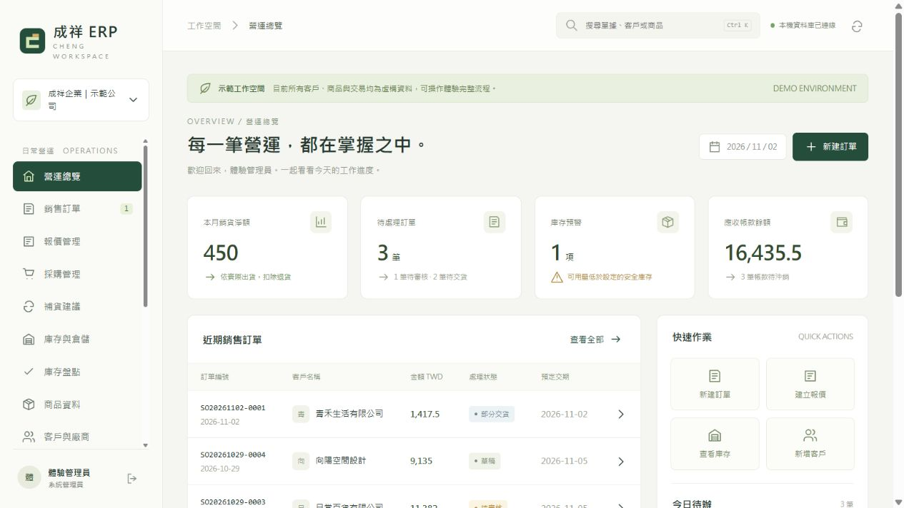

# 成祥 ERP · v0.3 核心試行版

繁體中文、單一公司、多使用者、多倉庫的買賣業 ERP。依目前提供的六張舊系統截圖、凌越功能研究，以及「完整取代舊系統、黃單就是報價／訂單、約 20 人使用、不需要自製、倉庫可自行新增」的需求開發。

目前是能實際寫入資料庫的核心試行版。正式全面切換前，還需要公司資料移轉、帳務規則確認、缺口補齊與上線驗收。

## 直接使用

Windows、macOS、Linux 均使用 Node.js **24**（本機已驗證 24.22.0，版本記錄於 `.nvmrc`）。目前沒有需要下載的 npm 依賴，不需要 `npm install`。

```sh
git clone https://github.com/kaukuai/ERP.git
cd ERP
npm run verify
npm run dev
```

`npm run dev` 啟動虛構示範資料，`npm run dev:company` 啟動此開發環境的公司工作空間。一般本機網址分別為 `http://127.0.0.1:4321`、`http://127.0.0.1:4320`。公司庫、密碼、備份、環境設定及完整廠商手冊不會隨 Git 同步。

也提供 GitHub Codespaces／Dev Containers 設定及 Windows／macOS／Linux 自動測試。[跨裝置與雲端開發說明](docs/GitHub與跨裝置開發.md) 包含 Codespaces 入口、分支同步與資料保留方式。

| 用途 | 啟動 | 瀏覽器網址 | 資料庫 |
| --- | --- | --- | --- |
| 體驗功能 | 雙擊 `demo.cmd` | [示範系統](http://127.0.0.1:4321) | `data/demo.sqlite` |
| 建立公司工作空間 | 雙擊 `start.cmd` | [公司工作空間](http://127.0.0.1:4320) | `data/company.sqlite` |

命令列也可以使用：

```powershell
node src/server.mjs --demo
# 或
node src/server.mjs
```

示範版按「進入示範工作空間」即可操作；客戶、商品、地址與交易皆為虛構。公司工作空間第一次開啟時，由使用者自行設定公司名稱與管理員密碼；沒有預設管理員密碼。正常啟動不會複製示範資料。

兩個環境使用不同的連接埠、登入 Cookie 名稱及 SQLite 檔案。關閉伺服器後資料仍會保留；要再次使用，重新啟動相同指令。

## 數碼一號手冊對標與本次升級

已核對 418 頁原廠公開手冊，建立可在系統內查詢的 115 項功能驗收清單：51 項可操作（限所列驗收範圍）、30 項部分具備、20 項待建置、14 項需外部整合。項目權重不同，不能當作工程完成百分比。

- [功能對標與驗收](docs/數碼一號功能對標與驗收.md)：八大章的來源頁次、現況、差距及驗收條件。
- [v0.3 操作與升級](docs/v0.3操作與升級.md)：本輪單位、稅別、揀貨、標籤、重建及新介面。
- [v0.2 操作與升級](docs/v0.2操作與升級.md)：新增功能、財務邊界、API、備份與升級方式。

新增介面為「進階作業中心」、「功能對標與驗收」、「聯絡與組織」、「資金與票據」。v0.3 仍未達到廠商全功能對等，剩餘工作均保留在清單中。

## 已可操作的功能

- 業務：查商品與各倉可用量、查客戶與歷史單據、專屬／零售／批發／網路／最近核准訂單帶價、多送貨地址、建立與修改報價／訂單、報價轉訂單、黃單預覽與瀏覽器列印／另存 PDF。
- 銷售：草稿、送審、退回、核准、庫存預留、分批出貨、未交追蹤、實物退貨、已收款部分建立待退款。
- 採購：採購草稿與審核、訂單轉採購及來源連結、重複採買數量檢查、分批進貨、進貨退出。
- 庫存：自行新增倉庫、多倉存量、預留量與可用量、調撥、調整、唯增流水、全倉安全存量與補貨建議。
- 盤點：帳面快照、儲存實盤、主管過帳差異、快照後異動檢查、預留量保護。
- 帳務：應收應付與期初未結、部分／批次沖帳、月結到期條件、預收預付沖抵、待退款、金額折讓、費用立帳與付款、帳齡、分錄、傳票、試算表、截止日控制。
- 資金與票據：自訂銀行／現金帳戶、期初餘額、帳戶轉帳、應收票據收票／託收／兌現、應付開票／交付／兌現、未兌現退票／作廢及履歷。
- 往來與追蹤：多聯絡人及地址、部門／員工到離職、客戶／供應商建檔、付款天數、信用額度、業務歸屬、聯繫紀錄、樣品借出入與部分歸還。
- 系統：六種固定角色、資料範圍與成本權限、操作稽核、CSV 預覽與整批匯入、CSV 匯出、資料庫線上備份、一致性檢查。

自製生產不是本公司的必要流程，因此主介面以買賣、借貨與歸還為主。程式內保留已驗證的單階 BOM／簡易組裝核心，後續若需要包裝組合可以再配置介面，不作為工廠製造系統交付。

## 推薦先操作一次

1. 進入示範版，按「新建訂單」。
2. 選「青禾生活有限公司」及保溫瓶：會帶出客戶專屬單價 450。
3. 填數量、交期與備註，按「儲存草稿」。
4. 按「黃單／PDF」確認版面。可選 A4 或 A5 橫式，以瀏覽器列印或另存 PDF。
5. 按「編輯草稿」修改後再儲存，再「送出審核」與「核准訂單」。
6. 「執行出貨」時可以只交一部分；之後查看庫存流水、應收帳款與會計傳票。
7. 到「系統與資料管理」執行一致性檢查。

## v0.3 新增流程

- 非庫存服務、多單位換算與單位條碼、售採購價、單據凍結快照。
- 逐列混合稅別、整單價格折扣、精確伺服器預覽、分批交退貨尾差。
- 直接進銷貨及剩餘未交結案，保留原交易與釋放對應預留。
- 批次揀貨、基本／箱包條碼核對、合併揀貨表、原子出貨回寫。
- 商品圖片、Code 128／EAN-13／QR 標籤、紙型與尺寸、盤點表及 CSV 實盤預覽。
- 成本重估、進銷明細及排行、部門分類快照、銀行分行、票簿、自訂單號。
- 管理員庫存／帳款重建，先預覽、自動備份、來源快照及總帳核對。

條碼引擎已隨程式附固定版本與 MIT 授權，不連外送出條碼內容，正常啟動不需要 npm install。

## 可自行擴充與目前邊界

管理員／主管能新增倉庫、商品、商品類別文字、客戶與廠商、客戶專屬價格；管理員能新增帳號。程式沒有將倉庫數或帳號數固定為特定值。20 個獨立帳號並行建單及資料隔離已有功能測試。

自訂角色、任意自訂欄位、表單設計器與多層簽核還未提供。單一公司與 TWD 是本版明確邊界。正式資料量、20 人長時間負載、異機連線與故障復原仍需驗收，不能把一次並行測試當作營運容量保證。

## 文件



| 文件 | 內容 |
| --- | --- |
| [研究與功能藍圖](docs/研究與功能藍圖.md) | 凌越、鼎新、正航與國外開源方案比較；完整功能矩陣 |
| [操作與資料移轉](docs/操作與資料移轉.md) | 各角色流程、黃單、盤點、匯入、備份還原與切換步驟 |
| [架構與 API](docs/架構與API.md) | 金額精度、交易、權限、資料關聯、介面與部署設定 |
| [上線缺口與開發順序](docs/上線缺口與開發順序.md) | 仍未完成的功能、20 人部署要求、正式替換的驗收門檻 |
| [驗證紀錄](docs/驗證紀錄.md) | 自動測試、人工操作與實際驗證範圍 |

## 驗證與開發

```powershell
node --check src/core.mjs
node --check src/server.mjs
node --check public/app.js
node --test tests/core.test.mjs tests/trading.test.mjs tests/finance.test.mjs tests/operations.test.mjs tests/http.test.mjs
```

亦可執行 `npm test`。HTTP 測試自行建立暫存資料庫、啟動本機服務並在結束後清理；不使用 `data/company.sqlite`。

`src/` 是伺服器與交易核心，`public/` 是瀏覽器介面，`tests/` 是自動驗證，`docs/` 是研究與交付文件，`data/` 存放執行時資料。資料庫與備份含公司資料及登入資訊，應由公司管理保存，不加入原始碼版本庫。
