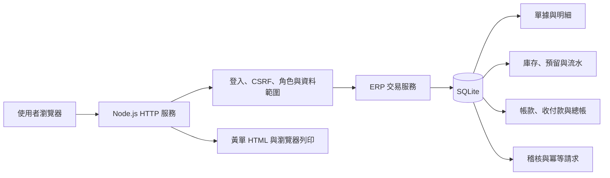
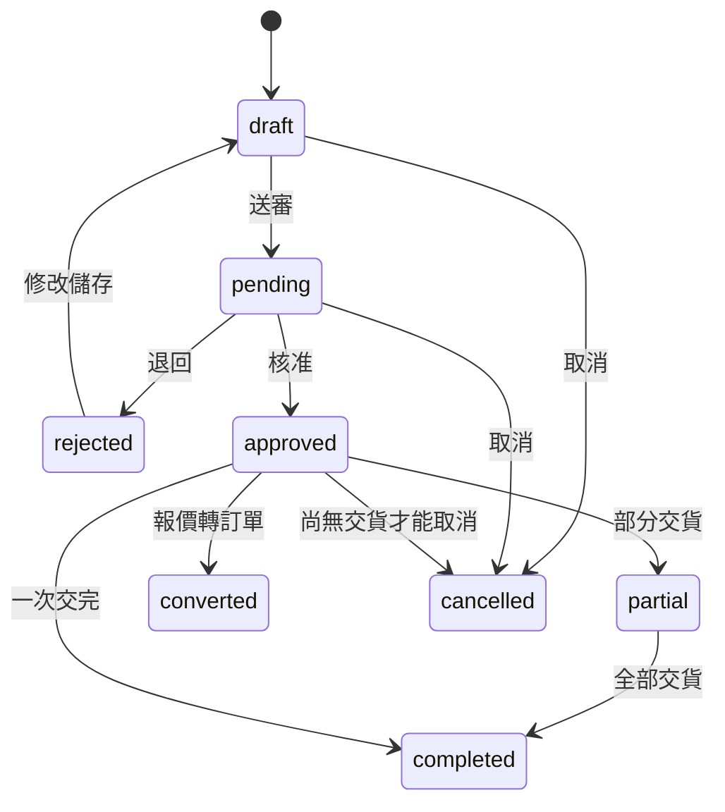
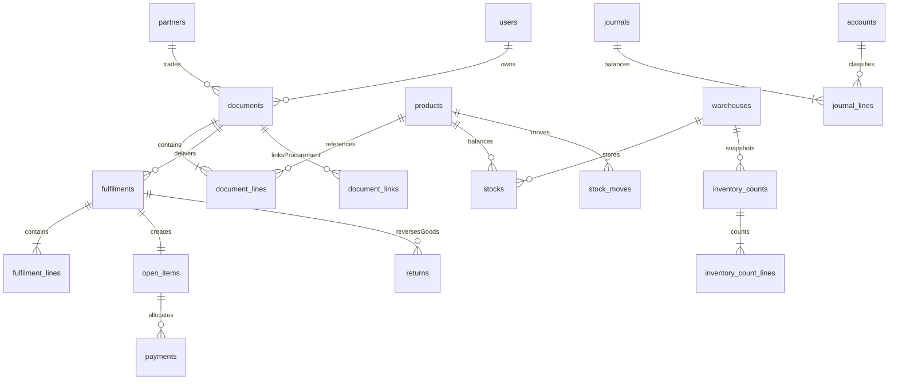

# 架構與 API

基準：2026-11-02，v0.4 多公司核心試行版。新增功能、遷移與限制見 [v0.4 操作與升級](v0.4操作與升級.md)，歷史流程另見 v0.2／v0.3 文件。

## 執行架構



瀏覽器靜態檔案由本服務供應，沒有外部 CDN 或第三方 npm 執行依賴。以 Node.js 24.22.0 驗證，使用內建 `node:sqlite` 的 `DatabaseSync` 與線上 backup API。[Node.js 24 SQLite 文件](https://nodejs.org/docs/latest-v24.x/api/sqlite.html)。

| 檔案 | 責任 |
| --- | --- |
| `src/schema.sql` | 表、外鍵、檢查、索引、流水防刪改觸發器 |
| `src/core.mjs` | 數值、角色、範圍、交易狀態、庫存、帳款、分錄 |
| `src/server.mjs` | HTTP、Cookie、CSRF、來源／Host、冪等、CSV、備份 |
| `src/print.mjs` | 黃單與 A4／A5 樣式 |
| `src/seed.mjs` | 獨立虛構示範資料 |
| `public/app.js`、`style.css` | 瀏覽器工作空間與響應版面 |

## 數值與交易

金額存整數「分」，單價最多兩位小數；數量存千分之一基本單位，最多三位小數。比例計算使用 BigInt 乘法與整數四捨五入，再檢查範圍。單列先把數量 × 單價算到分，再乘折數到分；最後算單據稅額。不同商品單位的總數只能當作作業計數。

分批交貨以累計分攤取差額，使所有批次金額與稅額合計等於原單。收貨各品存貨淨額合計等於該批收貨未稅額。預設 500 基點為可調整的 5% 作業設定；正式商品／交易稅別需由公司確認。只支援 TWD。

庫存、單據、帳款、總帳、稽核與冪等紀錄一起提交。外層使用 `BEGIN IMMEDIATE`，任一步失敗整筆回復。草稿及主檔版本號防止多人覆蓋；舊版本會收到 409。

同一使用者、同一冪等碼、同一角色及內容會取得原結果；內容或角色不同則衝突。資料庫也為單號與轉單來源設唯一限制。

目前由一個 Node 程序服務多個獨立 SQLite 帳套；每個帳套各自一個檔案。20 個獨立帳號並行建單已通過功能測試，但這不代表長期負載或高可用保證。不要啟動多個程序共用此檔作水平擴充，也不要把 SQLite 檔放在網路磁碟供各工作站直接開啟。

## 庫存與成本

`現有量 − 預留量 = 可用量`。核准訂單先預留，出貨才扣實體量；採購核准只計在途，實際進貨才增加實體量。缺貨訂單可先轉採購，採購入庫後再核准訂單；現版不支援缺貨核准／欠貨預留。

採每商品、每倉移動加權平均成本。最後全部出庫帶走剩餘全部成本；調撥一出一入，總量與總金額不變。銷退按原出庫成本回庫。進退依目前成本出庫，與原進貨淨額不同的部分列存貨調整損益。

盤點快照保留該倉最後流水 ID。即使異動後淨數量又變回原值，也會阻擋過期快照過帳。盤虧不能侵用已預留數量。

## 單據狀態



退貨保留原已交量，不會把原訂單重新打開。已有交貨不能直接取消；剩餘量終止尚未完成；已付款退款已加入待退款及獨立資金收付流程。已連動有效採購的來源訂單不能任意修改。

## 管理帳模型

收貨直接建立應付並借記存貨與進項；出貨直接建立應收、銷貨收入、銷項及銷貨成本。這是核心管理帳，尚未拆分收貨、供應商發票、客戶開票與收入認列時點。公司若採不同時點，需要增加相應文件與過渡科目。

`1000` 是銀行及現金共用科目。`1100` 應收、`1200` 存貨、`1250` 借出、`2000` 應付及 `2200` 借入為控制科目，一般傳票不能直接修改。傳票必須借貸平衡；固定科目表尚無使用者維護介面。

庫存流水、總帳及稽核設防更新／刪除觸發器；擁有資料庫檔案完整權限者仍可能破壞或替換檔案，因此還須作業系統權限、備份及外部監控。

## 資料關聯



客戶與商品文字在單據存檔時保留快照。黃單使用快照，公司的表頭使用目前公司設定；本版不是法定發票封存機制。

## 權限與工作階段

| 角色 | 範圍 |
| --- | --- |
| admin | 業務、系統設定、帳號、匯入、備份與檢查 |
| manager | 主檔、業務、採購、核准、庫存、帳款與成本 |
| sales | 負責／共用客戶、本人銷售單據與聯繫；商品及可用庫存；無成本、採購與帳務 |
| warehouse | 出入庫、調撥、借還、盤點登錄；無進價／成本；盤點過帳需主管 |
| finance | 帳款、收付款、傳票、成本；無庫存操作及核准 |
| viewer | 一般讀取，無寫入或成本 |

角色固定為六種。管理員可自行新增帳號，但尚不能自訂角色矩陣。建單與核准可以由同一主管執行，更嚴格的職務分離待做。

密碼為個別 salt 的 scrypt 雜湊；資料庫只存 session token 的 SHA-256。Cookie 為 HttpOnly、SameSite=Strict，期限八小時。停用、改權限或改密碼會撤銷工作階段。尚無 MFA／SSO。

## HTTP 契約

讀取以 Cookie 驗證；寫入為 JSON **物件**，需以下標頭：

```text
Content-Type: application/json
X-ERP-Request: 1
X-CSRF-Token: <登入結果的 csrf>
Idempotency-Key: <UUID，或 16–100 字英數、底線、連字號>
```

setup、login、demo 無需已登入 CSRF；logout 不要求冪等碼。所有寫入仍檢查必要標頭及瀏覽器 Origin；伺服器不開放 CORS 並檢查合法 Host。單次 JSON 最大 2MB。

| 方法與路徑 | 用途 |
| --- | --- |
| GET `/api/status` | 初始化狀態、日期、版本 |
| POST `/api/setup` | 一次性公司及管理員初始化 |
| POST `/api/login`、`/api/logout` | 登入登出 |
| GET `/api/session`、`/api/bootstrap` | 工作階段及權限過濾資料 |
| POST `/api/users`、`/api/settings`、`/api/password` | 使用者、公司、本人密碼 |
| POST `/api/partners`、`/api/products`、`/api/warehouses`、`/api/prices` | 主檔與專屬價 |
| POST `/api/documents` | 草稿建立／修改；修改需 id 與 version |
| GET `/api/documents/:id` | 單據明細與成本權限過濾 |
| POST `/api/documents/:id/submit` | 送審 |
| POST `/api/documents/:id/approve`、`/reject`、`/cancel` | 核准、退回、取消；後兩者需原因 |
| POST `/api/documents/:id/convert` | 報價轉訂單 |
| POST `/api/documents/:id/purchase` | 訂單轉採購草稿 |
| POST `/api/documents/:id/fulfil` | 分批交貨；`{lines:[{line_id,qty}]}`；省略 lines 交完未交量 |
| GET `/api/fulfilments/:id` | 出入庫明細 |
| POST `/api/returns` | 原出入庫 ID、來源列、數量與原因 |
| POST `/api/payments` | 單筆收付款沖帳 |
| POST `/api/adjustments`、`/api/transfers` | 庫存調整及轉倉 |
| POST `/api/inventory-counts` | 建立快照 |
| GET `/api/inventory-counts/:id` | 盤點明細 |
| POST `/api/inventory-counts/:id/save`、`/post`、`/cancel` | 儲存、過帳、取消；需版本 |
| POST `/api/loans`、`/api/loans/:id/return` | 借用與歸還 |
| POST `/api/activities` | 聯繫紀錄 |
| POST `/api/journals`；GET `/api/journals/:id` | 一般傳票及明細 |
| POST `/api/imports/preview`、`/api/imports/:id/commit` | 預覽及整批匯入 |
| GET `/api/export?kind=...` | products、partners、stocks、documents、open_items、moves |
| GET `/api/backup`、`/api/integrity` | 管理員備份與對帳檢查 |
| GET `/print/:id?size=a4` | 黃單；a5 為 A5 橫式 |

錯誤為 `{ "error": "訊息" }`。400 資料錯誤、401 未登入、403 權限／來源、409 版本／狀態／庫存／重複衝突、413 內容過大、429 登入頻率限制。未預期的 500 只回傳通用訊息，詳細錯誤留在伺服器。

API 回傳金額／數量為整數分／千分單位；表單寫入使用一般十進位字串。CSV 匯出已轉為一般金額／數量，不能混用。

## 部署參數

| 變數 | 預設與意義 |
| --- | --- |
| ERP_HOST | 127.0.0.1；服務綁定位址 |
| PORT | 公司 4320、示範 4321 |
| ERP_DB | 專案 data/company.sqlite 或 demo.sqlite；可指定其他本機資料磁碟；測試支援 :memory: |
| ERP_ALLOWED_HOSTS | 額外合法主機名，逗號分隔，不含 scheme／port；預設已允許 localhost 與 loopback |
| ERP_SECURE_COOKIE | HTTPS 部署時設 1 |

示範只能綁 loopback。多人部署應放在公司管理主機，配置 HTTPS 反向代理、正確 Host、憑證、服務常駐、備份與監控。本次沒有開放防火牆、公網或建立雲端服務。

多節點、高寫入與大量歷史查詢，需評估 PostgreSQL、背景工作及伺服器分頁；不要用資料庫檔複製實作多主寫入。

## v0.4 公司上下文與新增 API

請求以 `X-ERP-Company` 指定公司代碼，預設 `default`；列印使用 `?company=代碼`。兩者同時提供但不一致會拒絕。未知公司不會回退其他資料庫。公司上下文透過 AsyncLocalStorage 在每個請求中隔離，Cookie 名稱包含連接埠與公司代碼，登入、CSRF、冪等及資料庫均獨立。

`GET /api/companies` 只列供選擇登入的帳套名稱／代碼；`POST /api/companies` 限主要帳套管理員建立公司。`POST /api/company-summary-grants` 限來源公司管理員授權主要帳套帳號；`GET /api/company-summary` 限主要帳套財務角色，且只讀取有明確授權的公司。成本另檢查授權旗標與角色。

| 範圍 | 主要 API |
| --- | --- |
| 合併進出貨 | POST `/api/fulfilment-batches`，GET `/api/fulfilment-batches/:id`，GET `/print/fulfilment-batches/:id` |
| 批次月結 | GET `/api/monthly-bills/preview`，POST `/api/monthly-bills`，POST `/api/monthly-bills/:id/pay`，GET `/print/monthly-bills/:id` |
| 訂單外部欄位 | GET／POST `/api/documents/:id/metadata` |
| 分期排程 | POST `/api/subscriptions`，POST `/api/subscriptions/:id/status`，POST `/api/subscription-periods/:id/change` 或 `/execute` |
| SKU／訂單匯入 | POST `/api/sku-mappings`、`/api/order-import-templates`、`/api/order-imports/preview`、`/api/order-imports/:id/commit` |
| 自訂報表 | POST `/api/custom-reports`，GET `/api/custom-reports/:id`，GET `/print/custom-reports/:id` |
| 呆帳 | POST `/api/bad-debts`、`/api/bad-debts/:id/action`（approve／reject／recover／reverse） |
| 銀行對帳 | POST `/api/reconciliations/preview`、`/api/reconciliations/:id/commit` |
| 費用分攤 | POST `/api/expense-allocations/preview`、`/api/expense-allocations`，GET `/api/expense-allocations/:id`，GET `/print/expense-allocations/:id` |
| 背書／其他票據 | POST `/api/bill-restrictions`、`/api/endorsements`、`/api/endorsements/:id/action`、`/api/nontrade-bills`、`/api/nontrade-bills/:id/action` |
| 批號／序號 | POST `/api/inventory-tracking`，GET `/api/inventory-lots/:id`；出入庫／調整／調撥等接受批號分配，使用基本單位數量 |
| 字軌／發票設定 | POST `/api/invoice-ranges`、`/api/invoice-numbers`、`/api/invoice-print-profiles`、`/api/invoice-exchange-profiles`、`/api/invoice-exchanges/preview`、`/api/invoice-exchanges/:id/commit` |
| 維修／寄售／租賃 | POST `/api/repairs`、`/api/repairs/:id/action`、`/api/repairs/:id/parts`、`/api/service-contracts`、`/api/service-contracts/:id/sell` 或 `/return`、`/api/rental-periods/:id/charge` |
| POS | POST `/api/pos-stores`、`/api/pos-members`、`/api/pos-promotions`、`/api/loyalty-policy`、`/api/pos-shifts`、`/api/pos/quote`、`/api/pos/checkout`、`/api/pos-sales/:id/refund` |

所有新增 POST 保留原本 CSRF、請求標頭、JSON、Origin、權限與冪等契約。POS 收銀權限是逐店明確委派的狹義交易能力，價格、倉庫、促銷、點數與收款帳戶由伺服器建立，不接受用戶端的權限／售價／核准旗標；不放寬一般業務主檔與辦公室單據的資料範圍。
